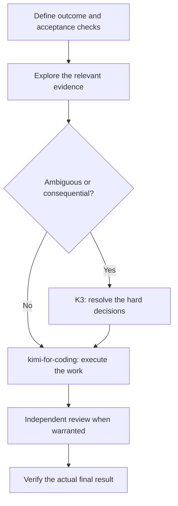

# Kimi Agent Team Guide

### The right model. The right effort. A result you can verify.

A practical field guide to choosing **K3, K3 256K, K2.8 Preview and K2.7 Code HighSpeed**, assigning work to specialist agents, and keeping quota and quality visible in [Kimi Code](https://www.kimi.com/code/).

**Checked against official documentation: 10 October 2026.** Recommendations are starting points to evaluate on your own tasks, not benchmark results or guarantees. This is an independent guide by [dextee](https://github.com/dextee), not a Moonshot AI publication.

Maintained by **[Dexter Ng](https://github.com/dextee), CTO & Cybersecurity Lead at [VYR](https://vyrwork.com/about)**. [Explore VYR Agent OS](https://vyrwork.com/agent-os?utm_source=github&utm_medium=referral&utm_campaign=kimi_agent_guide&utm_content=guide_intro) · [Work with VYR](WORK_WITH_VYR.md).

**Start with `kimi-for-coding` for everyday work. Step down to `kimi-for-coding-highspeed` for tight fix-and-test loops. Step up to K3 when ambiguity, long context or the consequences of a mistake justify it — and reach for `k3-256k` when the work fits in 256K tokens and you want the same answer at lower quota cost.**

| I want to… | Start here |
|---|---|
| Pick a model for today's task | [24-task selector](docs/task-selector.md) |
| Understand the models, context and effort | [Model guide](docs/models-context-effort.md) |
| Set up a reusable team | [Setup instructions](SETUP.md) |
| Route models to sub-agents | [Subagents and the model pool](docs/subagents-and-model-pool.md) |
| Copy a complete workflow prompt | [Workflow recipes](docs/workflows.md) |
| Use Kimi models in other tools | [Third-party tools](docs/third-party-tools.md) |
| Manage quota and cost | [Quota and cost](docs/quota-and-cost.md) |
| Check the evidence and limitations | [Sources](SOURCES.md) · [Validation](VALIDATION.md) |
| Apply this to a business process | [Scope a workflow with VYR](WORK_WITH_VYR.md) |

## Choose in 30 seconds

| Model | Our starting use | Example |
|---|---|---|
| **`kimi-for-coding`** (K2.8 Preview) | Everyday work that needs judgment and follow-through | Implement a feature, review a change, research a decision, produce a proposal |
| **`kimi-for-coding-highspeed`** (K2.7 Code HighSpeed) | Small, repeatable edits in a rapid loop | Mechanical fixes, formatting sweeps, renames, quick test iterations |
| **`k3-256k`** (K3, 256K context) | Demanding synthesis that fits in 256K tokens | Multi-file audit, migration plan, reconcile conflicting evidence — at lower quota cost |
| **`k3`** (K3, up to 1M context) | Ambiguous problems, whole-codebase reasoning, long documents | Resolve competing explanations, design a consequential change, audit a large system |

The general model positioning comes from [Kimi's official overview](https://www.kimi.com/code/docs/en/): K3 is Kimi's flagship for long-horizon programming and complex reasoning, and Kimi reports output up to 260 tokens/s across its tiers. The HighSpeed tier is described by Kimi as roughly 5–6× the output speed of Standard on the same underlying model. Our scenario assignments are editorial recommendations; thinking effort levels (`low` / `high` / `max`) apply to K3 and K2.8 Preview. See [models, context and effort](docs/models-context-effort.md).

**Membership gates matter:** on current plans, Kimi Code and K3 need **Plus** or above; the 1M context window and HighSpeed need **Pro** or above (legacy names: Andante/Moderato/Allegretto map to the same gates). Model choice you cannot access is not a choice — [check your plan](docs/quota-and-cost.md).

## The recommended team

Use **`kimi-for-coding` / high effort** as the everyday lead. Start a specialist only when its output will change the next action. You do not need all seven on every task.

| Agent | Model / effort | Job and output |
|---|---|---|
| [Architect](agents/guide_architect.md) | K3 / max | Resolve ambiguity; return a plan, tradeoffs and acceptance checks |
| [Implementer](agents/guide_implementer.md) | K3 / high | Complete a feature; return changed files and relevant verification |
| [Explorer](agents/guide_explorer.md) | kimi-for-coding / low | Read-only search; return paths, symbols and useful evidence |
| [Reviewer](agents/guide_reviewer.md) | kimi-for-coding / high | Routine independent review; return reproducible findings |
| [Auditor](agents/guide_auditor.md) | K3 / max | Demanding final review across requirements and evidence |
| [Researcher](agents/guide_researcher.md) | kimi-for-coding / high | Collect sources, reconcile claims and flag uncertainty |
| [Editor](agents/guide_editor.md) | kimi-for-coding / low | Turn verified material into clear audience-appropriate writing |

These are Kimi Code custom agent definitions: Markdown files whose frontmatter sets the agent's name, description and **tool permissions**, and whose body is its system prompt. Kimi agent files do **not** pin a model — model routing happens through `/model`, `/secondary-model` and the `[secondary_model]` pool. [How the pieces fit together](docs/subagents-and-model-pool.md).

### The everyday loop



Parallelize independent research or separate files. Keep dependent steps in order. Give one agent ownership of each shared writable file or external record. Sub-agents consume quota independently, so dispatch them when isolation or parallelism pays for itself.

## Install the reusable agents

Requires a current Kimi Code CLI with access to the selected models. There is no installer: Kimi discovers agent Markdown files automatically by directory. Copy the roles you want:

```bash
git clone https://github.com/dextee/kimi-agent-team-guide.git
cd kimi-agent-team-guide

# Project scope — one repository
mkdir -p /path/to/your/project/.kimi-code/agents
cp agents/guide_*.md /path/to/your/project/.kimi-code/agents/

# Or user scope — every project
mkdir -p ~/.kimi-code/agents
cp agents/guide_*.md ~/.kimi-code/agents/
```

Then start Kimi Code in the project and ask:

```text
Use guide_explorer to map the code involved in this feature. Have
guide_implementer build the change, then ask guide_reviewer to inspect it
independently. Keep the requirements and final verification in the main thread.
```

Project-scoped agent files ship with the repository itself — review `.kimi-code/agents/` in unfamiliar repos before trusting them, the same way you would review scripts. [Full setup, model routing and rollback](SETUP.md).

## Choose the smallest useful team

| Situation | Suggested arrangement |
|---|---|
| Small edit with clear instructions | One `kimi-for-coding` session, low or default effort |
| Everyday implementation | kimi-for-coding lead; explorer sub-agent; reviewer if needed |
| Complex feature or migration | K3 lead; architect first; scoped implementers; auditor at the end |
| Research brief | kimi-for-coding lead; researchers split by question; editor after evidence is ready |
| Ambiguous incident | K3 lead at max effort; separate evidence investigations; one owner for remediation |
| Rapid fix-and-test loop | highspeed for the mechanical cycles; step up when a failure resists three attempts |

This guide's team sizes and role assignments are hypotheses to test. More agents can increase coordination work and total token consumption.

## Recipes you can use today

The [recipe library](docs/workflows.md) includes feature delivery, hard bugs, research, proposals, data reconciliation, refactors, document repair, repository audits and budget-sensitive automation. Each gives you a recommended model, effort, handoff and completion check.

### A better delegation brief

```text
Outcome: [the result required]
Context: [only the sources and decisions needed]
Owner: [one agent / one writable area]
Model and effort: [kimi-for-coding / low-high-max, k3, or highspeed]
Scope: [files, pages, records or questions]
Acceptance: [observable checks]
Return: [result, evidence, unresolved issues, recommended next action]
```

## Keep quality and cost visible

- Check `/usage` during long sessions; Kimi Code quota is shared across CLI, Desktop, VS Code and API keys.
- A rolling 5-hour rate window applies: sustained bursts trigger rate limiting that recovers as the window rolls over. Extra Usage balance, if enabled, keeps work moving when subscription quota is exhausted.
- Start a new session after switching models: switching invalidates the existing prompt cache and raises consumption.
- Use an escalation trigger: unclear requirements, conflicting evidence, repeated failure or a consequence that deserves stronger review.
- Check permissions and tool availability before attributing a failure to the model.

Use the [evaluation worksheet](templates/evaluation.csv) and [quota guide](docs/quota-and-cost.md). Membership quota and API-style billing are different measures; this guide does not estimate your subscription quota from API prices.

## Relationship to the Claude and GPT guides

This companion follows the same five-role spine as the earlier guides — architect, implementer, worker/explorer, reviewer and auditor — and adapts it to Kimi Code's agent model: Markdown custom agents, a subagent model pool, and thinking-effort levels instead of per-agent model pins. The guides form a series:

- **Claude Code Agent Team Guide** — preserved at [its original Git commit](https://github.com/dextee/vyr-agent-os-workflows/tree/d227750cba963e48eb38035d84c5d339c2d7f877).
- **ChatGPT Agent Team Guide** — [github.com/dextee/chatgpt-agent-team-guide](https://github.com/dextee/chatgpt-agent-team-guide).
- **Kimi Agent Team Guide** — this repository.

Role and effort mappings from both earlier guides are tabulated in [from GPT and Claude](docs/from-gpt-and-claude.md).

## Apply the approach with VYR

The [VYR Agent OS showcase](https://github.com/dextee/vyr-agent-os-workflows) translates agent workflows into business examples. Its internal operations, sample-data demo and custom-build designs carry separate status labels.

For a potential implementation, share the recurring task, current tools, monthly volume, budget range and target start date. **[See the process and send a workflow brief](WORK_WITH_VYR.md)** · [Review current Agent OS status](https://vyrwork.com/agent-os?utm_source=github&utm_medium=referral&utm_campaign=kimi_agent_guide&utm_content=guide_business).

This guide is an educational resource maintained alongside Dexter's commercial work at VYR. The model recommendations are not evidence of VYR customer outcomes or a Moonshot AI endorsement.

## Diagrams and maintenance

All diagrams in this guide are hand-written [Mermaid](https://mermaid.js.org/) source rendered by Kimi Code, the GitHub web UI or your own toolchain — no generated images are shipped, so there is no unverifiable artwork provenance to maintain.

For corrections, include the official source, the affected task and the date checked. See [contributing](CONTRIBUTING.md) and the [source register](SOURCES.md). Model access, tiers and interfaces can change after the verification date.
